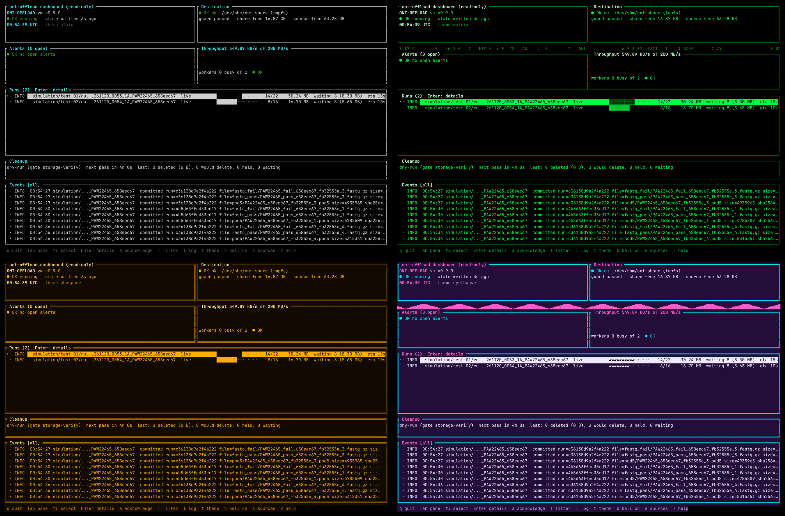

<h1 align="center">ont-offload</h1>

<p align="center">
Auditable and controlled transfer of ONT sequencing data from local to mounted network storage
</p>

<p align="center">
<a href="https://github.com/esteinig/ont-offload/actions/workflows/ci.yml"></a>
<a href="https://esteinig.github.io/ont-offload"></a>
<a href="LICENSE"></a>
</p>

<p align="center">

</p>


`ont-offload` is a toolkit for transfer of live and completed runs to mounted storage with end-to-end verification, guarded writes, outage tolerance, machine-readable audit trail, and operational reports. 

Development was conducted under IEC 62304 (software safety class B) guidelines with requirements, hazards, and tests traceable for compliance.

## Overview

- Multiple sources watched by one daemon (e.g. production runs, simulation, manual transfer folders with `READY` markers)
- Real-time transfer of live and completed runs to mounted drives (NFS, SMB), with the MinKNOW directory structure preserved
- Total bandwidth capped by `rate_limit` shared across parallel workers, with share benchmarking (`ont-offload bench`)
- Guided setup with `ont-offload init` including site presets (`local`, `test`, `production`, `promethion`)
- Live monitoring with `ont-offload status` and the terminal dashboard (`ont-offload tui`)

## Controls

- Simulated MinKNOW runs for testing and validation with `ont-runsim` (fault injection, outages, resumable long runs)
- Source deletion optional and disabled by default, with configurable pre-deletion checks and dry-run mode
- Writes are refused unless the destination is confirmed as mounted (re-checked before every transfer)
- Files hashed (SHA-256) during transfer and committed by atomic rename
- A `sha256sum -c` compatible manifest, `run.json` and `COMPLETE` markers for each run
- Independent storage-side verification (`ont-offload verify`) with `VERIFIED.json` receipts
- Transfers paused during network outages of any duration, or low share capacity, andresumed automatically
- Live state published as `state.json` and `events.jsonl`, with optional `notify_command` (Slack, email, ...)
- Complete audit trail for event and ste logs, journal records retained for compliance 
- Typst reports (PDF/A-2b) for verification of simulations and playback runs
- IVD software hazard register with risk controls traceable to code and tests (IEC 62304, class B)

## Quickstart

The steps below set up a local test bench, in which a tmpfs folder (`/dev/shm/ont-share`) stands in for the network share, and transfer a simulated 2-hour run in about 2 minutes. Linux (or WSL2) required - since the destination guard reads `/proc/self/mountinfo`.

### 1. Installation

Full feature set `tui` and `report` with `conda` or `mamba`:

```sh
mamba install -c steinig/label/molpath ont-offload
```

Compile from source:

```sh
cargo install --locked --features tui,report --git https://github.com/esteinig/ont-offload ont-offload
cargo install --locked --git https://github.com/esteinig/ont-offload/tools/ont-runsim
```

The `tui` feature adds the terminal dashboard and `report` the PDF rendering of reports. Release archives with prebuilt binaries (both features included) and comliance records are attached ([release](https://github.com/esteinig/ont-offload/releases)) - see also the [installation guide](docs/src/user-guide/installation.md).

### 2. Initialisation

```sh
ont-offload init                                   # ~/ont-local
export ONT_OFFLOAD_CONFIG=~/ont-local/config.toml  
ont-offload check-config                           # config warnings
```

A templated configuration is written from a preset, then the state, log and source folders (`runs`, `transfer`, `simulation`) are created, a sentinel file is placed on the share, a write probe is conducted and its esult validated, and the remaining config steps output to console. Warnings about nested source roots and the dry-run cleanup configuration are expected with the `local` preset.

### 3. Simulated transfer

The daemon is started in the first terminal:

```sh
ont-offload watch          # resumes from journal 
```

A simulated run is written from a second terminal. `quick-2h` preset produces two hours of a run at 60x speed: 47 files (pod5, FASTQ and BAM batches, sample sheet, final summary) and 67 MB over two minutes runtime:

```sh
SIM="~/ont-local/data/simulation/test-01"
ont-runsim run --preset quick-2h --out $SIM --keep-free 1GB
```

Files are transferred as they settle after transfers ceases (configurable). On completion, the manifest and `COMPLETE` are written and the copy can be checked independently of `ont-offload` with `sha256sum`:

```sh
RUN=$(ls -d /dev/shm/ont-share/simulation/test-01/*/*/*/ | tail -1)
ont-runsim check --out ~/ont-local/data/simulation/test-01 --dest "$RUN"   # 47 of 47 files match
(cd "$RUN" && sha256sum --quiet -c manifest.sha256 && echo "sha256sum OK")
ont-offload verify "$RUN" --source                                         # writes VERIFIED.json
```

### 4. Monitoring

Daemon state is read from a third terminal, without any effect on the transfer:

```sh
ont-offload status                  # one-shot summary
ont-offload tui --theme matrix      # terminal dashboard
```

The dashboard shows the destination and guard state, throughput, per-run progress, open alerts and the event stream, with themes `plain`, `matrix`, `phosphor` and `synthwave`. 

Settings, keys and the `ont-offload-tui` launcher described in the [dashboard guide](docs/src/user-guide/tui.md). Outage, crash-recovery and cleanup drills for the same test bench are given in the [`Testing on a laptop`](docs/src/user-guide/local-testing.md) guide.

### 5. Deployment on a sequencer

Offload service configuration written to default `/etc/ont-offload/config.toml` - systemd unit, sysusers, logrotate and `tui.env` files to `/etc/ont-offload/systemd/`, with installation commands in next steps printed to console:

```sh
sudo ont-offload init --preset production --share /mnt/nas/ont-offload                            # service account ont-offload
sudo ont-offload init --preset promethion --share /mnt/hpc/ont-offload --data /data/data-offload  # default account prom
sudo systemctl enable --now ont-offload # after service files installed
```

Service files have to be manually installed after `init` - preset options and source flags are documented in [Setting up with init](docs/src/user-guide/init.md). Operation as a dedicated service user, log rotation and parallel operations are described in the [deployment guide](docs/src/user-guide/deployment.md), with limitations and controls in [the user guide](docs/src/user-guide/limitations.md). 

An annotated example configuration is provided in [`packaging/ont-offload.example.toml`](packaging/ont-offload.example.toml) and a reference systemd unit in [`packaging/ont-offload.service`](packaging/ont-offload.service).

## Commands

| Command | Purpose |
| --- | --- |
| `init` | Configuration from a preset (`local`, `test`, `production`, `promethion`) |
| `watch` | Continuous transfer of live and completed runs (daemon mode) |
| `run` | Transfer of a single completed run |
| `verify` | Verification of a transferred run and generation of a receipt |
| `cleanup` | Manual source deletion pass, subject to all deletion gates |
| `bench` | Suggested transfer settings for a given share |
| `check-config` | Configuration validation, including a share write probe |
| `report` | Clinical operations reports (JSON record and PDF/A-2b) - see [Reports](docs/src/user-guide/reports.md) |
| `status`, `tui` | Read-only views of daemon state and as a terminal dashboard |

## Exit codes

| Code | Meaning |
| --- | --- |
| 0 | All runs transferred and verified |
| 1 | Internal error, or command not implemented |
| 2 | Configuration or destination guard refusal |
| 3 | One or more files or runs failed |
| 4 | Unresolved integrity mismatch |
| 5 | `report verify`: `INCONCLUSIVE` (no input for required check) |
| 75 | Restart required (workers stalled after an outage - resumable) |
| 130 | Interrupted (journal consistent - resumable) |

## Development

```sh
cargo xtask test      # unit, integration and doc tests
cargo xtask lint      # rustfmt + clippy warnings
cargo xtask trace     # traceability (medtrace, or the built-in check)
cargo xtask ci        # full suite
```

The branching model, commit conventions and traceability tags are documented in the [developer guide](docs/src/developer-guide/setup.md) and [CONTRIBUTING.md](CONTRIBUTING.md).

## Regulatory

Development was conducted under IEC 62304 (software safety class B) guidelines with [medtrace](docs/src/developer-guide/compliance.md). Requirements, software items and hazards are maintained in [`compliance/`](compliance/).

## License

Copyright (C) 2026 Eike Steinig. Licensed under the GNU Affero General Public License v3.0 or later - see [LICENSE](LICENSE).
